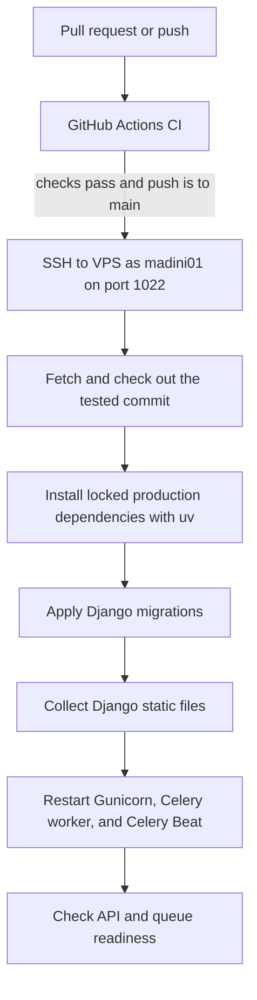

# Backend production deployment

This guide describes the TGPMIS backend deployment to the Ubuntu VPS. The
GitHub Actions workflow deploys a tested commit from `main` to the existing
Gunicorn service; it does not create or configure the VPS, PostgreSQL, Nginx,
or the production `.env` file.



## What the workflow does

The workflow is [`.github/workflows/ci.yml`](../.github/workflows/ci.yml).
Pull requests run CI only. A push to `main` deploys only after CI succeeds.

| Stage | Checks or actions |
| --- | --- |
| CI | Install dependencies; Ruff lint and format checks; auth schema registration; Django production deployment check; missing-migration check; PostgreSQL 16 migrations; pytest with coverage. |
| Deploy | Connect with SSH; reject a dirty VPS checkout; fetch and check out the pushed commit; install locked production dependencies; migrate; collect static files; restart Gunicorn, Celery worker, and Celery Beat. |
| Health check | Retry `GET /api/health/ready/` for up to 60 seconds; fail if the API is not ready. Check queue and worker health with systemd and Celery logs. |

The deploy job uses the GitHub `production` environment and a concurrency group
so production deployments do not run simultaneously. It checks out the exact
commit that passed CI.

## 1. VPS prerequisites

The workflow expects the existing backend checkout and tools at these paths:

| Item | Expected value |
| --- | --- |
| Deployment user | `madini01` |
| SSH host and port | `41.59.229.28:1022` |
| Backend checkout | `/home/madini01/tgpmis-backend-production` |
| `uv` executable | `/home/madini01/.local/bin/uv` |
| systemd service | `tgpmis-gunicorn.service` |
| Celery worker | `tgpmis-celery-worker.service` |
| Celery Beat scheduler | `tgpmis-celery-beat.service` |
| Redis broker | `redis-server.service` with AOF persistence enabled |
| Gunicorn listener | `127.0.0.1:8000` |
| Public API base URL | `https://api.tgpmis.tgc.ac.tz` |

The checkout must have the GitHub repository as `origin`, be writable by
`madini01`, and have no tracked or untracked changes when a deployment starts.
The workflow checks `git status --porcelain` and stops if the tree is dirty.
Keep the production `.env`, uploads, and other runtime data out of Git; ensure
the repository ignores them.

Check the deployment paths and service as `madini01`:

```bash
cd /home/madini01/tgpmis-backend-production
git status -sb
git remote -v
test -x /home/madini01/.local/bin/uv && echo "uv executable"
systemctl is-active tgpmis-gunicorn.service
```

The service must load the production environment and bind Gunicorn to
`127.0.0.1:8000`. Production settings, database configuration, static/media
files, and required environment values are covered in the
[operations guide](engineering/operations.md).

Install and enable Redis plus the two Celery systemd units in
[`deploy/systemd/`](../deploy/systemd/). Configure `CELERY_BROKER_URL` and
`CELERY_RESULT_BACKEND` in the backend environment file. Keep Redis bound to
localhost or a private socket, enable append-only persistence, and do not expose
its port publicly. PostgreSQL inbox and outbound-request rows remain the recovery
source if Redis or a worker is restarted.

On the VPS, install the unit files and start the services before deploying code
that imports the GePG task handlers:

```bash
sudo install -o root -g root -m 0644 deploy/systemd/tgpmis-celery-worker.service /etc/systemd/system/
sudo install -o root -g root -m 0644 deploy/systemd/tgpmis-celery-beat.service /etc/systemd/system/
sudo systemctl daemon-reload
sudo systemctl enable --now redis-server.service
sudo systemctl enable --now tgpmis-celery-worker.service tgpmis-celery-beat.service
systemctl is-active redis-server.service tgpmis-celery-worker.service tgpmis-celery-beat.service
```

Set `appendonly yes` and `bind 127.0.0.1` in the Redis service configuration,
then restart Redis. Keep the broker URL local unless the infrastructure uses a
private authenticated Redis endpoint.

### Allow only the required service restart

The deploy script uses `sudo -n`, which cannot prompt for a password. Grant
`madini01` permission to restart this one systemd unit using `visudo`:

```bash
sudo visudo -f /etc/sudoers.d/tgpmis-deploy
```

Add this rule:

```sudoers
madini01 ALL=(root) NOPASSWD: /usr/bin/systemctl restart tgpmis-gunicorn.service, /usr/bin/systemctl restart tgpmis-celery-worker.service, /usr/bin/systemctl restart tgpmis-celery-beat.service
```

Validate the file and confirm the command is allowed without a password:

```bash
sudo visudo -cf /etc/sudoers.d/tgpmis-deploy
sudo chmod 0440 /etc/sudoers.d/tgpmis-deploy
sudo -n -l /usr/bin/systemctl restart tgpmis-gunicorn.service
sudo -n -l /usr/bin/systemctl restart tgpmis-celery-worker.service
sudo -n -l /usr/bin/systemctl restart tgpmis-celery-beat.service
```

The last command should list the restart command as permitted. It does not
restart the service.

## 2. Configure the backend GitHub environment

GitHub environments belong to a single repository. Configure this in
**TGCTZ/TGC-SERVICE-BACKEND → Settings → Environments**; settings in the
frontend repository are separate.

Create an environment named `production`. Restrict deployments to the `main`
branch. Leave required reviewers empty for automatic deployment.

Add these **environment variables**:

| Name | Value |
| --- | --- |
| `SSH_HOST` | `41.59.229.28` |
| `SSH_PORT` | `1022` |
| `SSH_USER` | `madini01` |
| `API_URL` | `https://api.tgpmis.tgc.ac.tz` |

`API_URL` is the origin only; the workflow appends `/api/health/ready/`.

Add these **environment secrets**:

| Name | Value |
| --- | --- |
| `SSH_PRIVATE_KEY` | The Actions private key, including its begin/end lines. |
| `SSH_KNOWN_HOSTS` | The verified host-key line for `[41.59.229.28]:1022`. |

The matching public key must be in `madini01`'s `~/.ssh/authorized_keys`. The
host key must be verified from the VPS; do not use an SSH banner as a host key.
Never commit either private key or production `.env` values.

## 3. Route the API hostname to Gunicorn

The HTTPS Nginx server block for `api.tgpmis.tgc.ac.tz` must be active and
proxy the Django paths to `http://127.0.0.1:8000`. It should include the API,
admin, health, GePG, verification, and billing paths, plus the forwarding
headers that tell Django the original request used HTTPS. Keep a `403` fallback
for unrelated paths so the API hostname does not serve the frontend.

The current server block is stored in `sites-available` but has not yet been
enabled. Before enabling it, inspect `sites-enabled` for existing blocks using
the same TGPMIS hostnames. Replace or disable only the old TGPMIS blocks; keep
the other applications' Nginx sites enabled. Then validate and reload:

```bash
sudo nginx -t
sudo systemctl reload nginx
```

The API hostname replaces the legacy `/billing/` socket route with TGPMIS
Gunicorn. Preserve the existing TLS certificate configuration. The backend
`.env` must allow `api.tgpmis.tgc.ac.tz` in `ALLOWED_HOSTS`; the frontend origin
`https://tgpmis.tgc.ac.tz` must be in `CORS_ALLOWED_ORIGINS`. See the
[frontend deployment guide](https://github.com/TGCTZ/TGC-SERVICE-FRONTEND/blob/main/docs/deployment.md)
for the matching frontend and API-host setup.

## 4. Validate before deploying

Test Gunicorn directly, then through Nginx. The forwarded headers simulate the
headers Nginx sends to Django:

```bash
curl -i --max-time 15 \
  -H 'Host: api.tgpmis.tgc.ac.tz' \
  -H 'X-Forwarded-Proto: https' \
  http://127.0.0.1:8000/api/health/

curl -i --max-time 15 \
  -H 'Host: api.tgpmis.tgc.ac.tz' \
  -H 'X-Forwarded-Proto: https' \
  http://127.0.0.1:8000/api/health/ready/

curl -i https://api.tgpmis.tgc.ac.tz/api/health/ready/
```

Both health endpoints should return `200`. Liveness checks that the process
responds; readiness also checks the database and migration state. Resolve an
empty reply, timeout, or non-200 response before allowing a push to `main` to
deploy.

## 5. Deploy and verify

After the workflow is merged into `main`, open the backend repository's
**Actions** tab. A pull request to `main` should run CI without deploying. A
successful push or merge to `main` should show the test and deploy jobs. The
deploy job uses the secrets and variables from the `production` environment.

Check the public readiness endpoint after deployment:

```bash
curl -i https://api.tgpmis.tgc.ac.tz/api/health/ready/
```

The expected response is `200`. The workflow retries for 60 seconds and then
reports failure if readiness does not recover.

## Failure handling and rollback

The workflow does not automatically roll back. If deployment fails after
checkout or migrations, inspect the failed step, service journal, and database
before retrying. A code rollback can be made by reverting the deployment commit
on `main`, which triggers another deployment; first confirm the new migration
is backward-compatible with the previous code. Take regular PostgreSQL and
runtime-file backups as described in the
[operations guide](engineering/operations.md#what-to-back-up).

| Symptom | Likely cause |
| --- | --- |
| Deploy job does not start | The workflow is not on `main`, or the event was a pull request. Pull requests run CI only. |
| Missing SSH variables or secrets | Add them to this backend repository's `production` environment; frontend environment settings are separate. |
| `Permission denied (publickey)` | The private key does not match `madini01`'s authorized public key, or SSH permissions are wrong. |
| SSH timeout | Check host `41.59.229.28`, port `1022`, and the VPS firewall. |
| Dirty checkout | Check `git status` in `/home/madini01/tgpmis-backend-production`; the workflow refuses to overwrite local changes. |
| `sudo: a password is required` | Validate the `tgpmis-deploy` sudoers entry with `visudo -c` and `sudo -n -l`. |
| API returns `403` | The new Nginx server block may not be active, or another active block may own the hostname. |
| API returns `502` | Nginx cannot reach Gunicorn at `127.0.0.1:8000`, or Gunicorn is not serving requests. |
| Empty reply or worker timeout | Check `ss -ltnp`, `journalctl -u tgpmis-gunicorn.service`, and both direct health endpoints. |
| Readiness returns `503` | Check database connectivity and apply any pending migrations. |
